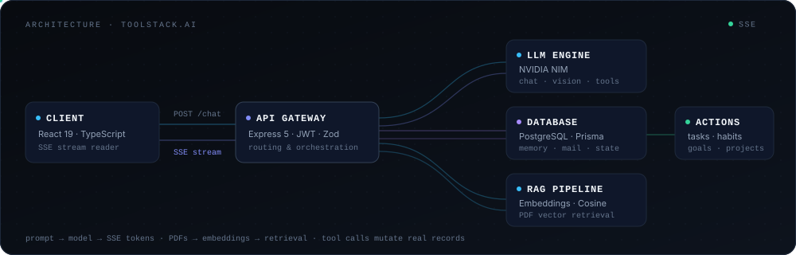

<div align="center">



</div>

<br>

> *"I like systems that move data between things: a Postgres row to a Raspberry Pi screen, a PDF to a vector index, a model token to a browser, one at a time."*

| | |
| :--- | :--- |
| **Role** | Full Stack Developer @ **TechPlek Technologies** *(Intern → Full-Time, 2026)* |
| **Location** | New Delhi, India · Online since Dec 2025 |
| **Focus** | Role-based platforms · Streaming AI · Self-hosted hardware |
| **Education** | BCA, GNIOT Institute of Professional Studies *(2023–2025)* |

<br>


### `01` · Now

**Mapglo** — *Out-of-home advertising analytics platform* `Active`

- Site creation workflow and the backend API powering it
- Role and permission system (RBAC) for vendor and agency teams
- Three distinct role-based portals plus the public landing experience
- v1 AI chat assistant integrated via a unified provider interface

<sub>`Next.js 15` · `TypeScript` · `Tailwind CSS`</sub>

<br>


### `02` · Featured — ToolStack AI

**One workspace for chat, documents, vision, mail, and persistent memory.**

[`Live Demo ↗`](https://toolstack-ai.vercel.app) &nbsp;·&nbsp; [`Source Code ↗`](https://github.com/hritikS0/ToolstackAi)

<br>

<div align="center">



</div>

<br>

| Capability | Implementation |
| :--- | :--- |
| **Stream** | SSE token streaming with automatic non-streaming fallback |
| **Vision** | Multimodal image-attachment chat |
| **Memory** | Long-term memory store persisting across conversations |
| **Actions** | Tool calling that creates and updates real tasks, habits, goals, and projects |
| **Docs** | PDF chat via RAG — vector embeddings + cosine-similarity retrieval |
| **Mail** | IMAP sync with AI triage: categories, urgency scores, summaries, and reply drafts |
| **Security** | API keys and mail credentials encrypted at rest; Zod validation on every input |

<br>


### `03` · Stack

<div align="center">



</div>

<details>
<summary><code>tree ~/stack</code> &nbsp;— plain-text view</summary>

```text
~/stack
├── frontend   React · Next.js · Tailwind CSS · Material UI · TanStack Query
├── backend    Node.js · Express · REST · JWT · RBAC · Prisma · Mongoose · Zod
├── data       PostgreSQL · MongoDB · Redis · Amazon S3
├── ai         LLM APIs · tool calling · RAG · vector embeddings · semantic search · SSE
├── infra      Linux · PM2 · Docker / Compose · GitHub Actions · Vercel · Render · Tailscale
└── languages  TypeScript · JavaScript · Python
```

</details>

<br>


### `04` · Hardware & Shipped

**Android Home Lab** — *Self-hosted Linux server on a spare Android phone, zero hosting cost*
- **Runtime:** Termux running Node.js services managed by PM2 with auto-restart
- **Deploy:** Automated GitHub Actions pipeline deploying in under 45 seconds
- **Network:** Tailscale private mesh — SSH from anywhere with zero public ports exposed

**Shailshuta Logistics** — *Shipment tracking & customer operations*
- 20+ REST endpoints backed by Prisma + PostgreSQL
- JWT authentication with route-level RBAC middleware
- Linux staging deployments with PM2, log rotation, and error alerting

**pDOOH Signage Platform** — *Digital signage for Raspberry Pi players*
- Backend and admin console for media distribution and device synchronization
- S3 pre-signed URLs so players pull media directly from object storage
- Reworked boot and provisioning scripts for lower memory usage and higher player stability

<br>


### `05` · Connect

<div align="center">

[`Portfolio`](https://hritiik.me) &nbsp;·&nbsp; [`LinkedIn`](https://www.linkedin.com/in/hritik-sharma-91336430b/) &nbsp;·&nbsp; [`GitHub`](https://github.com/hritikS0) &nbsp;·&nbsp; [`Email`](mailto:sharmahritik8077@gmail.com)

<br>



</div>
