 

<em>Full-stack developer, New Delhi.</em> 
<em>I enjoy building things behind the scenes — APIs that connect systems, databases that keep things organised, services that communicate, and backend logic that makes complex applications feel effortless.</em>

## Selected Works

### I. ToolStackAI
*An AI workspace, 2026* &nbsp;·&nbsp; [live](https://toolstack-ai.vercel.app) &nbsp;·&nbsp; [source](https://github.com/hritikS0/ToolstackAi)

> **Medium:** React, TypeScript, Node.js, Express, PostgreSQL, Prisma, NVIDIA NIM, Supabase 
> **Dimensions:** one workspace, many tools

Chat that streams token by token, with a fallback when a stream drops. Vision chat over image attachments and a long-term memory store. PDF chat built on a RAG pipeline: vector embeddings with cosine-similarity retrieval. The model can call tools to create and update real tasks, habits, goals and projects from plain-language requests. An IMAP mail sync triages the inbox with categories, urgency scores, summaries and reply drafts. API keys and mail passwords are encrypted at rest, and every request is validated with Zod.

 

### II. Android Home Lab
*A spare phone, promoted to server*

> **Medium:** Linux, Termux, Tailscale, GitHub Actions, PM2 
> **Cost to host:** nothing

An old Android phone running persistent Node services. Remote administration over a private Tailscale network, with no public ports exposed. A GitHub Actions pipeline deploys to the device in under 45 seconds, and PM2 restarts the services.

 

### III. Commissions
*Built at TechPlek Technologies, Dec 2025 – Present*

**Mapglo — Outdoor Advertising Analytics Platform** (React, Next.js 15, TypeScript, Tailwind CSS, Node.js, MongoDB, Geospatial Data)
Two-sided OOH location-intelligence SaaS: discover, compare and shortlist outdoor media sites, with agency, vendor and admin portals. Built the site-creation form and backend API for listing outdoor media sites, implemented custom role creation and granular RBAC permissions for vendor and agency teams, developed three role-based portals plus the public landing page, and integrated an AI chat assistant through the platform's AI provider interface.

**Aavya Holidays — Resort Membership** (Next.js, Node.js, PostgreSQL, SMS OTP (DLT), Payments)
Multi-resort privilege-card platform: members buy cards and redeem room, F&B, spa and upgrade vouchers; resort staff verify via OTP; admin manages offers, blackouts and reports. Built member-facing interfaces, backend APIs for membership management and coupon redemption, and a web-based OTP verification flow to prevent unauthorized redemptions.

**Shailshuta Logistics** (React, TypeScript, Node.js, Express, PostgreSQL, Prisma)
Shipment tracking and customer operations: 20+ REST endpoints, JWT authentication with route-level role-based access control, and Linux staging deploys monitored with PM2 (log rotation and error alerts included).

**Digital Signage Platform** (React, Node.js, PostgreSQL, AWS S3, Raspberry Pi, Linux)
Backend services and an admin console that distribute media to Raspberry Pi players and keep them in sync. Players download straight from S3 through pre-signed URLs instead of through the API server. I reworked the boot and provisioning scripts to lower the player's memory use and make it more stable.

## The Palette

The full colour chart

- **Languages:** JavaScript (ES6+), TypeScript, Python, HTML5, CSS3
- **Frontend:** React.js, Next.js, Tailwind CSS, Material UI, Redux, Zustand
- **Backend:** Node.js, Express.js, REST APIs, JWT Authentication, RBAC, Prisma ORM, Mongoose, Zod
- **Data:** PostgreSQL, MongoDB, Redis, Amazon S3
- **AI:** LLM API Integration, Tool Calling, RAG, Vector Embeddings, Semantic Search, SSE Streaming
- **Studio equipment:** Linux, Docker, Docker Compose, PM2, Git, GitHub Actions, Vercel, Render, Tailscale

## Visit the Studio

[**LinkedIn**](https://www.linkedin.com/in/hritik-sharma-91336430b/) &nbsp;·&nbsp; [**GitHub**](https://github.com/hritikS0) &nbsp;·&nbsp; [**Email**](mailto:sharmahritik8077@gmail.com)

 

<em>Open to interesting work.</em>

